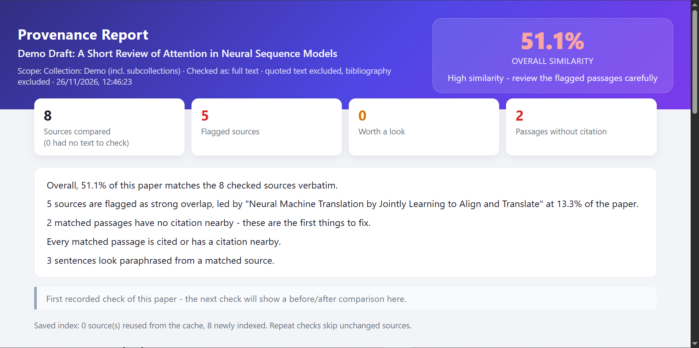
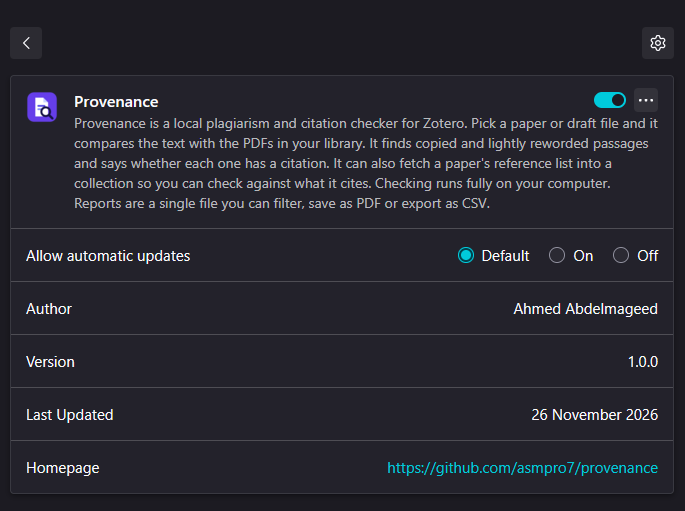
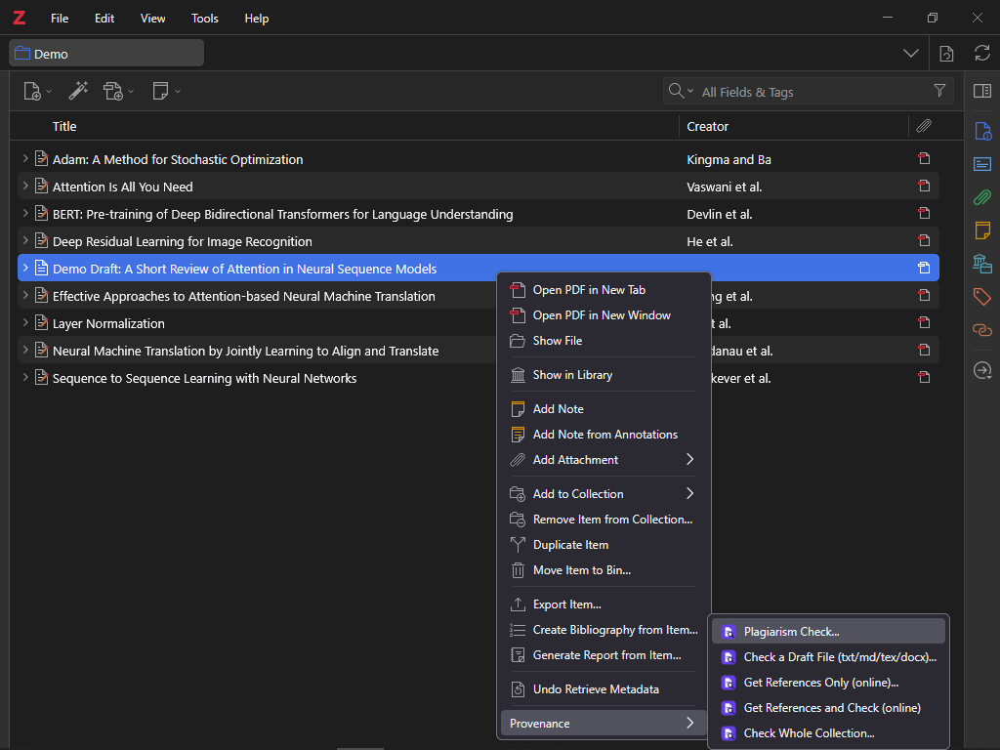
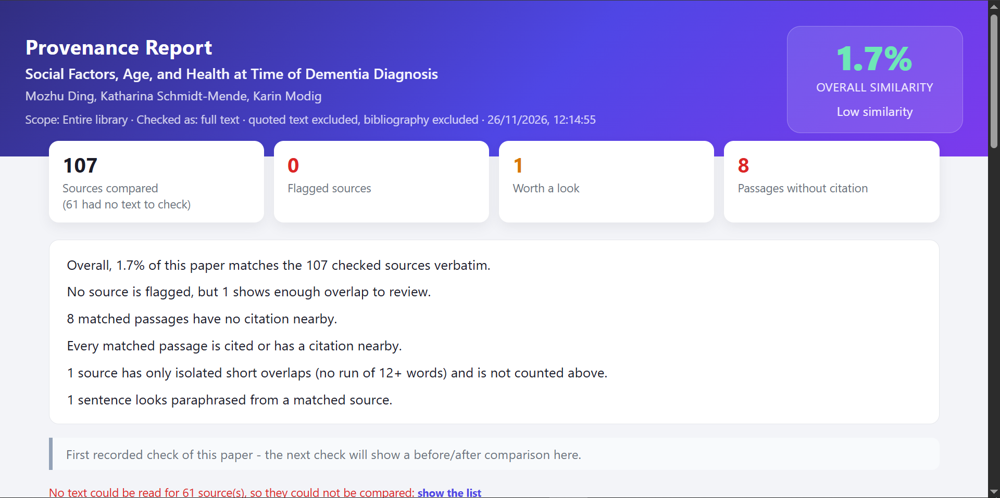
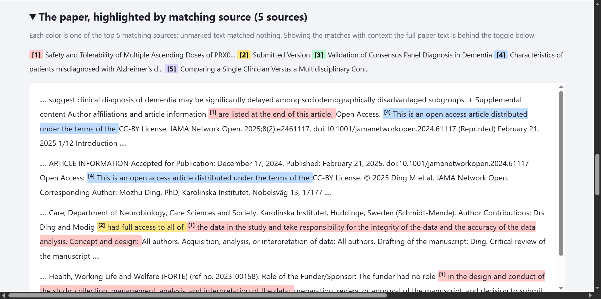
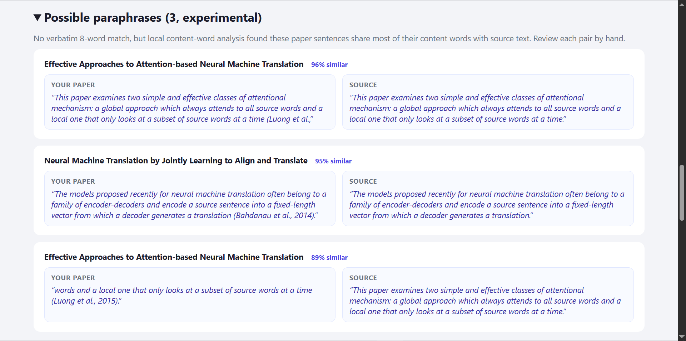
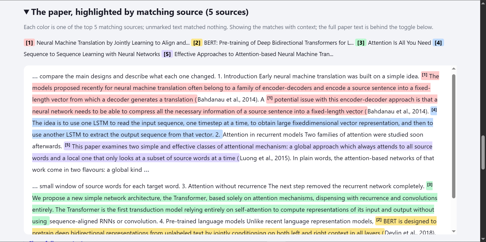
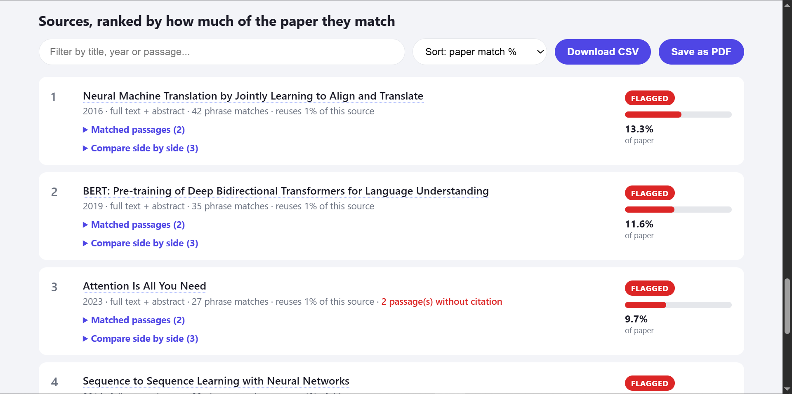
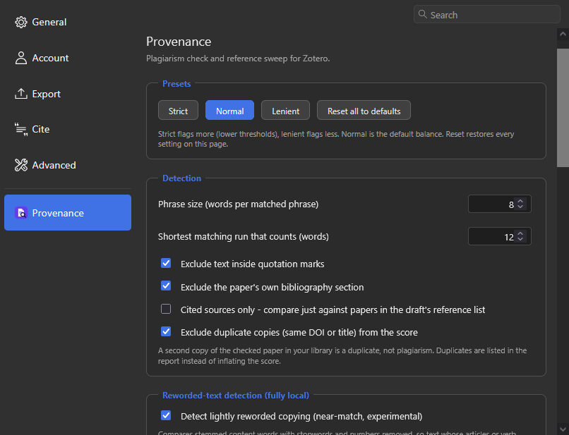

<p align="center">
  
</p>

<h1 align="center">Provenance</h1>

<p align="center">
  A local plagiarism and citation checker for Zotero.<br>
  Compare a paper or draft with the PDFs in your library and see what overlaps and whether it is cited.
</p>

<p align="center">
  <a href="https://github.com/asmpro7/provenance/releases/latest"></a>
  <a href="LICENSE"></a>
  
</p>

<p align="center">
  
</p>

## Features

- **Plagiarism check.** Pick a paper in your library, or a draft file (`.txt`, `.md`, `.tex`, `.docx`), and compare it with the PDFs in your library.
- **Copied and lightly reworded passages.** Finds verbatim matches and near-matches, and flags sentences that look paraphrased from a source.
- **Citation status.** Says whether each matched passage has a citation nearby.
- **Reference fetching.** Fetches a paper's reference list into a collection, so you can check against what it cites.
- **Whole collection checks.** Check every paper in a collection in one run.
- **One-file reports.** Filter, sort, save as PDF or export as CSV.
- **Duplicates handled.** Duplicate copies of the same paper are listed separately and do not inflate the score.
- **Presets and settings.** Strict, Normal and Lenient presets, plus detailed thresholds.
- **Standalone PDFs.** PDFs without a parent item work as the checked paper and as sources.

## Screenshots

**Plugin details in Zotero**



**Right-click a paper, then Provenance.** The same five actions are also in the Tools menu.



**Progress while a check runs**, ending with the overall similarity and the report opening in your browser.



**Report summary.** Overall similarity, sources compared, flagged sources and passages without a citation.


**Longest matched passages**, with word counts.



**Possible paraphrases.** Sentences that share most of their wording with a source, shown side by side.



**The paper, highlighted by matching source.** Each color is one of the top matching sources.



**Sources, ranked by how much of the paper they match**, with filter, sort, CSV and PDF export.



**Settings.** Strict, Normal and Lenient presets, plus detection options such as phrase size, shortest matching run, exclusions and reworded-text detection.



Demo screenshots quote short passages from open-access arXiv papers (Vaswani et al., Devlin et al., Bahdanau et al., Sutskever et al., Luong et al.) for illustration only.

## Install

1. Download `provenance-<version>.xpi` from the [latest release](https://github.com/asmpro7/provenance/releases/latest).
2. In Zotero, open **Tools, then Plugins**.
3. Click the gear icon, choose **Install Plugin From File**, and pick the downloaded `.xpi`.

Works with Zotero 7 to 10. Updates are delivered from this repository.

## Usage

Select a paper in your library, then open **Tools, then Provenance** (or right-click the item):

| Menu item | What it does |
| --- | --- |
| Plagiarism Check... | Compares the selected paper with the PDFs in your library and writes a report. |
| Check a Draft File (txt/md/tex/docx)... | Checks a draft from a file on disk. |
| Get References Only (online)... | Fetches the paper's reference list into a collection you choose. |
| Get References and Check (online) | Fetches the references, then checks the paper against them. |
| Check Whole Collection... | Checks every paper in a collection. |

Reports are saved as a single HTML file and open in your browser when the check finishes.

## Settings

Open **Edit, then Settings, then Provenance** (on macOS, Zotero, then Settings). You can choose the Strict, Normal or Lenient preset, or tune match length, thresholds, exclusions (quoted text, bibliography, duplicates), near-match and paraphrase detection, the reference limit and the fingerprint index that speeds up repeat checks. "Reset all to defaults" restores the defaults. See the settings screenshot above.

## Privacy

Checking runs fully on your computer. The only online feature is reference fetching, which contacts [Semantic Scholar](https://www.semanticscholar.org/) and is labelled "(online)" in the menu.

Provenance compares only against sources in your own library, not the whole web. Treat results as leads for manual review, not proof of plagiarism.

## Build from source

You need Python 3. From the repository root:

```bash
python3 build.py
```

This writes `provenance-<version>.xpi`, with the version read from `manifest.json`. See [docs/RELEASING.md](docs/RELEASING.md) for the release steps.

## Author

[Ahmed Abdelmageed](https://orcid.org/0009-0002-7902-690X)

## License

[MIT](LICENSE)
